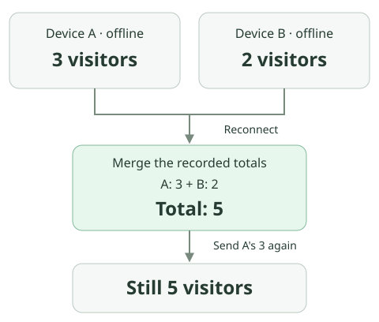

# What is a CRDT?

A CRDT is a way to store data so that people can change separate copies and combine them later. It stands for **conflict-free replicated data type**.

Imagine two devices counting visitors while offline. When they reconnect, their counts combine without counting the same update twice.

The trick is to store more than the final number. Each device keeps its own running total. Combining those records is called **merging**. A text CRDT does something similar: it tracks which characters were added or deleted so separate edits can be combined.

## What pg_crdt adds to Postgres

pg_crdt gives you two column types:

| Type | Use it for |
| --- | --- |
| `crdt.pn` | A count that goes up and down, such as counts collected by separate devices. |
| `crdt.yseq` | Shared plain text, such as a short note edited by two people. Experimental. |

You store these columns in your own tables and call SQL functions to change them. Your app handles sign-in, permissions, sending updates and saving offline copies. pg_crdt does not connect devices for you.

## Do you need one?

Use a CRDT when separate copies need to change independently. If every change already goes through one server, an ordinary number or text column is usually simpler.

A merged counter can go below zero. It cannot promise that disconnected devices will respect a shared limit, such as stock remaining.

Text merging cannot decide what people meant when they replace the same sentence. Show users the merged result. Text columns also rewrite the whole stored value on each edit and retain information about deleted characters. Start with short documents saved occasionally; read the [storage limits](reference/storage.md#text) before choosing them.

## Start building

The five-page guide takes about 10–20 minutes, including the SQL examples:

1. You are here: what a CRDT is.
2. [Install pg_crdt](install.md).
3. [Try a counter](get-started/quickstart.md).
4. [Try shared text](get-started/text.md).
5. [Application principles](guides/app.md).

Use [guides](README.md#guides) for practical tasks and [reference](README.md#reference) for API details. The separate [research](../research/README.md) covers design decisions and benchmarks.
